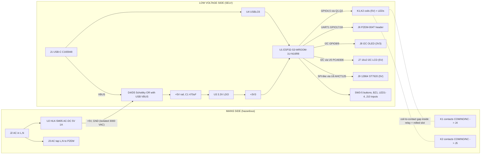

# BorePilot (ESP32-S3 Pump Controller) - project plan (v0, planning only)

Date: 2026-10-28. Author of plan: Claude session for ElectroIoT. **Nothing here is drawn, built or tested.** No schematic, PCB or firmware exists yet. All GPIO numbers, part choices and distances are proposals for the owner to approve.

> **Mains warning.** This board connects 230 V AC (HLK module input, fuse, varistor, relay contacts, screw terminals). Every item in section 7 and the "Safety items for an engineer" list in section 14 must be reviewed by a qualified person before any board is powered from mains.

## 1. Goals and scope

Build a new ESP32-S3 pump controller board that replaces the Wemos D1 Mini + relay module + loose HLK-PM01 stack of [Smart-Submersible-Pump-Controller-ESPHome](https://github.com/ElectroIoT/Smart-Submersible-Pump-Controller-ESPHome) with one PCB, and succeeds the earlier [PUMP-SENTRY-S3](../PUMP-SENTRY-S3) attempt (reviewed 2026-10-17; fresh start requested).

In scope for v1:
- ESP32-S3-WROOM-1U-N16R8 module (U.FL, external antenna; owner choice 2026-10-28), Wi-Fi, ESPHome firmware (same entities as the old package, plus extra protection).
- PZEM-004T v3 energy meter on a 4-pin header (external module, as in the old project).
- 2 relays (SPDT), **each with COM / NO / NC on its own screw terminal**.
- Hi-Link HLK-5M05 5 V module powers everything; 3.3 V LDO for the ESP32-S3.
- USB (part C165948) for flashing, logging and 5 V bench power.
- Three selectable display options on one board: 16x2 I2C LCD, I2C OLED, 128x64 ST7920 LCD.
- **Wireless tank-level unit (owner decision 2026-10-28):** a separate battery or USB-powered ESP32 node at the water tank sends level data to BorePilot over ESP-NOW (section 5A). No extra radio on the BorePilot PCB.
- 3 front-panel buttons (START, STOP, MENU), EN/BOOT, buzzer, status LEDs, 2 dry-contact inputs (float switches) and spare GPIO header.

Out of scope for v1: switching a motor directly through the PCB (see 7.4), 3-phase, battery backup, Ethernet, custom enclosure design (enclosure is a later phase), measuring AC on the PCB (PZEM does that).

## 2. What the old project does and how it maps to the new board

Read from `packages/pump-controller.yaml` (ESPHome >= 2026.8.0, ESP8266 D1 Mini):

| Old behaviour | Old pin / setting | New board |
|---|---|---|
| Start relay, **momentary pulse** 2.5 s, active-low module, wired across the contactor panel's Start push-button | D1 (GPIO5) | K1, GPIO4, active-high, pulse 2.5 s (substitution kept). Use K1 COM+NO across the START push-button. |
| Stop relay, pulse 2 s, wired across the Stop button | D2 (GPIO4) | K2, GPIO5, pulse 2 s. K2 COM+NC can alternatively break a hold-in loop. |
| PZEM-004T v3 over UART 9600 (ESPHome `pzemac` on `modbus`, address 1, update 2 s): voltage, current, power, energy, frequency | D5 RX, D6 TX (UART0 pins, so serial logging was disabled) | UART1 on GPIO17 (TX) / GPIO18 (RX). Logging moves to native USB (`hardware_cdc`), so it is no longer sacrificed. |
| `pump_running_status` binary sensor: current > `running_amps` (0.5 A) | - | same, plus run-state held in firmware (`pump_commanded_on`). |
| Dry-run: when current enters range below `dry_run_amps` (1.0 A) and `pump_running_status` is on, pulse the Stop relay | - | same intent, rewritten (see 2.1). |
| Wi-Fi + fallback AP + captive portal, API encryption, OTA password, HA dashboard | - | unchanged. Switch to `esp32:` with `framework: type: esp-idf`, board `esp32-s3-devkitc-1`. |

### 2.1 Observation about the old dry-run logic (my reading, not tested)
`running_amps` (0.5 A) is lower than `dry_run_amps` (1.0 A) and the trigger is `on_value_range: below: 1.0` that also requires `pump_running_status` (current > 0.5 A). The stop therefore only fires while current is between 0.5 and 1.0 A. A pump that drops straight to about 0 A (cable fault, tripped contactor) never satisfies the condition, and the status sensor is evaluated from the same sample. For the new firmware keep a latched `pump_commanded_on` flag (set when START fires, cleared when STOP fires or current stays below `running_amps` for N seconds) and add: start-up grace time, hysteresis, over-current, over/under-voltage cut-out, and a minimum off-time. **To be confirmed with the owner (question Q5).**

## 3. Block diagram



## 4. GPIO assignment (ESP32-S3-WROOM-1U-N16R8)

Rules used: avoid strapping pins GPIO0 (BOOT only), GPIO3, GPIO45, GPIO46; GPIO19/20 reserved for native USB; GPIO26-32 are the module's flash (not available); GPIO33-37 are **left unused** so an R8 (octal PSRAM) module could be dropped in later; GPIO43/44 (UART0) go to a test-pad pair only. Display pins reuse the numbers from the Wattglint/PayDisplay 12864 projects so existing U8g2/ESPHome knowledge carries over (CS 10, MOSI 11, CLK 12, RST 14; backlight moved to 13).

| GPIO | Net | Dir | Notes |
|---|---|---|---|
| EN | EN | in | SW1 reset button, 10 k pull-up, 100 nF to GND |
| 0 | BOOT | in | SW2 to GND (strapping pin; nothing else attached) |
| 19 / 20 | USB_D- / USB_D+ | io | via U4 USBLC6 to J1 (native USB Serial/JTAG) |
| 8 / 9 | I2C_SDA / I2C_SCL | io | 4.7 k pull-ups to 3V3; OLED J8 directly, 16x2 LCD J7 via U5 PCA9306 |
| 17 / 18 | PZEM_TX / PZEM_RX | out / in | UART1 9600 8N1 to J6. RX through 4.7 k + 10 k divider (PZEM TX level assumed 5 V, **unverified**) |
| 4 | RLY1 | out | Q1 gate, 100 k pull-down, active-high |
| 5 | RLY2 | out | Q2 gate, 100 k pull-down, active-high |
| 10 | LCD_CS (ST7920 RS) | out | via U6 gate 1 |
| 11 | LCD_MOSI (ST7920 R/W) | out | via U6 gate 2 |
| 12 | LCD_CLK (ST7920 E) | out | via U6 gate 3 |
| 14 | LCD_RST | out | via U6 gate 4 |
| 13 | LCD_BL | out | Q3 gate (PWM), 100 k pull-down |
| 1 | BTN_START | in | SW3 to GND, internal pull-up, firmware debounce |
| 2 | BTN_STOP | in | SW4 |
| 6 | BTN_MENU | in | SW5 |
| 15 | BUZZER (optional, DNP-able) | out | Q4 gate (LEDC PWM), 100 k pull-down |
| 16 | LED_STATUS | out | LED2 red via 1 k |
| 39 | IN1 | in | J10 (screw terminal), float/level switch 1 (dry contact, internal pull-up) |
| 40 | IN2 | in | J11 (screw terminal), float/level switch 2 |
| 41, 42 | SPARE1, SPARE2 | io | J12 |
| 43 / 44 | TXD0 / RXD0 | out / in | two test pads (optional external UART logging) |
| 21, 38, 47, 48 | - | - | unused; 47/48 also on J12 |

Relay LEDs LED3/LED4 are driven by the relay-coil rail (parallel with the coil through Q1/Q2), so they show the actual coil state, not the GPIO state. 3V3 pull-up on GPIO inputs is internal; add external 10 k only if testing shows noise.

## 5. Display options (select one, two I2C displays can coexist)

All three headers are on the board. Choose by **fitting only the header you need** and setting one substitution in the ESPHome YAML (`display_type: lcd16 | oled | st7920`). There is no switch to move; parts that serve only one option are DNP otherwise, so the unused circuit costs nothing and cannot interfere.

| | A: 16x2 I2C LCD | B: I2C OLED | C: 128x64 ST7920 |
|---|---|---|---|
| Header | J7, 1x4 2.54 male: GND, 5V, SDA, SCL (typical PCF8574 backpack order, **check your module**) | J8, 1x4 male: GND, 3V3, SCL, SDA (typical 0.96" SSD1306 order; **some modules are VCC/GND swapped**, check) | J9, 1x20 2.54 female (standard 12864B pin order: 1 VSS, 2 VDD, 3 V0, 4 RS, 5 R/W, 6 E, 7-14 DB0-7, 15 PSB, 16 NC, 17 RST, 18 VOUT, 19 BLA, 20 BLK) |
| Supply | 5 V | 3V3 | VDD 5 V (backlight BLA 5 V via module resistor; BLK to GND through Q3) |
| Bus / pins | I2C GPIO8/9 through U5 PCA9306 (backpack I2C pull-ups usually go to 5 V) | I2C GPIO8/9 direct | GPIO10 (RS/CS), 11 (R/W/SID), 12 (E/SCLK), 14 (RST) through U6 SN74AHCT125 to 5 V logic, GPIO13 backlight |
| Address | 0x27 / 0x3F | 0x3C / 0x3D | n/a (serial mode) |
| Extra parts | U5 + 4 x 4.7 k | none | U6, RV2 contrast trimmer (V0), Q3, SJ1 solder jumper PSB-to-GND (**bridged by default = serial mode**) |
| ESPHome | `lcd_pcf8574` | `ssd1306_i2c` | `st7920` (SPI) |

Why level shifting: a PCF8574 backpack pulls SDA/SCL to its 5 V rail, and an ST7920 on 5 V needs about 3.5 V for a logic high (0.7 x VDD), more than the ESP32-S3's 3.3 V. The old PUMP-SENTRY-S3 review flagged the backpack pull-up problem as unverified; this design removes it instead of relying on it. The ST7920 serial-mode and PSB-to-GND details, plus the V0/VOUT contrast wiring, **must be confirmed against the actual 12864B module and the ST7920 datasheet** (not read in this session). A mixed fit (OLED + 16x2 together) works because the addresses differ, but only one of them should be configured in firmware per device.

Optional later: firmware I2C scan that picks the display automatically.

## 5A. Wireless tank unit over ESP-NOW (new, firmware + separate small board)

Idea: a second ESP32 at the tank reads a level sensor and sends it to BorePilot, which starts the pump on LOW and stops it on FULL (and ignores the wired floats J10/J11 or uses them as a backup). BorePilot's ESP32-S3 already has the radio, so **the BorePilot PCB does not change**.

- **Link:** ESP-NOW (peer-to-peer, no router). Range is claimed to be tens to 100+ m in open air; **not measured for your site**. ESP-NOW and Wi-Fi share the radio, so both ends must use the same Wi-Fi channel as BorePilot's router connection; the tank node learns it by pairing (button) or a fixed channel setting.
- **Tank node hardware options** (none selected, no LCSC lookups done): ESP32-C3 or ESP32 board; sensor = float switch (simplest), ultrasonic (JSN-SR04T waterproof) or submersible pressure transducer; power = USB adapter, 18650 + solar, or deep-sleep on 2 x AA (wakes every 30-60 s, sends, sleeps).
- **Messages:** tank to BorePilot every N seconds: level %, state (LOW/MID/FULL), battery V, sequence number. BorePilot to tank: ack. Packet carries a shared key / MAC allow-list (ESP-NOW encryption for unicast).
- **Safety logic in BorePilot firmware:** if no tank message for `tank_timeout` (default 120 s) the controller falls back to the wired floats or to manual mode and raises an alert; it never starts the pump from a stale reading; overflow guard stops the pump on FULL even if the link is lost mid-run (timer cap on run time).
- **ESPHome:** ESPHome has no built-in ESP-NOW node in the version assumed here (needs checking against 2026.8+); likely options are an external component or small custom code. **Unverified.**
- **GPIO:** none needed on BorePilot.
- **New work items:** tank-node firmware, pairing procedure, run-time cap, HA entities (tank level, tank battery, link OK), test in the real tank at real distance.

## 6. USB: C165948 is USB-C, not micro-USB

**Verified on lcsc.com (2026-10-28) and from the datasheet:** C165948 = Korean Hroparts **TYPE-C-31-M-12**, a **16-pin USB Type-C receptacle, SMD right-angle**, 20 V / 5 A contact rating, -30 to +80 C, 8.94 x 7.35 mm body, 4 SMD shield tabs + 2 locating pegs, pin 1-16 table A1/B12 GND, A4/B9 VBUS, A5 CC1, B5 CC2, A6/B6 D+, A7/B7 D-, A8 SBU1, B8 SBU2. Stock 283,620, $0.1886 at 5+ ($0.0975 at 5000), SMT Extended. The earlier OpenRelay-8 BOM lists the same part as USB-C. **The request said "micro USB"; I assumed the part number is what you want and designed for USB-C (Q1 asks you to confirm).** A genuine micro-B alternative would be a different part (not looked up).

USB path:
- D+/D- (A6/B6 and A7/B7 tied together on the board) -> U4 USBLC6-2SC6 -> GPIO20 / GPIO19, short and 90 ohm differential if layout allows.
- **CC1 and CC2 each need a 5.1 k pull-down** (R1, R2). This is *not* optional for USB-C to USB-C cables (without them a C-to-C host supplies no VBUS); it is the main difference from micro-B.
- VBUS -> D5 Schottky -> +5V; HLK output -> D4 Schottky -> +5V. A Schottky on each source stops the HLK back-feeding a USB host and stops VBUS back-feeding the HLK. Drop about 0.4 V, so +5V is about 4.6 V on either source; relay pull-in at 5 V coil is <= 75 % = 3.75 V (datasheet), so margin is fine.
- Shield: tie to GND through 1 M || 100 nF (DNP-able) or direct; decide in schematic.
- **No CH340/CP2102 and no auto-reset transistors**: ESP32-S3 native USB Serial/JTAG gives flashing, console and DTR/RTS-style auto-reset to esptool. Fallback: hold BOOT, tap EN. GPIO19/20 must stay on USB.
- Safety: USB ground = HLK secondary ground. They are isolated from mains only as far as the HLK (3000 VAC) and the relay coil-to-contact insulation (1500 VAC per Songle datasheet) go. **Do not plug a laptop into the board while mains is connected unless the engineer review accepts this**; bench rule: program on USB with mains disconnected.

## 7. Mains side: isolation, creepage and safety design

### 7.1 Mains entry
J2 (AC in, 2-way 5.08 mm) -> HLK-5M05 AC pins and J3 (2-way tap terminal feeding the PZEM-004T's voltage input). **Owner decision 2026-10-28: no on-board fuse and no varistor.** The HLK datasheet marks both as mandatory ("must be connected"), so protection must then come from the panel (MCB/fuse upstream of J2); this is a safety item for the engineer review. the datasheet also lists a 0.1 uF/275 VAC X2 capacitor and a 10-15 mH common-mode choke that are **needed for EMC certification but are not placed** in v1 (open item). No protective earth is carried on the board: if the pump has an earth lead it goes to the enclosure/terminal block, not through the PCB (Q8).

### 7.2 Isolation barrier
- Zones: left/bottom "mains" zone (J2, U2 AC pins, J3, relay contact pins, J4, J5), right/top "SELV" zone (everything else). The barrier is a **routed slot** of at least 1.0 mm width, with no copper and no silkscreen-only separation.
- The HLK module straddles the barrier: AC pins on the mains side, DC pins on the SELV side. Confirm the module pin spacing against its datasheet drawing (not checked).
- Relays straddle it too: coil pins on the SELV side, COM/NO/NC pins on the mains side. SRD-05VDC-SL-C is rated 1500 VAC coil-to-contact (datasheet). Treat that as **basic/functional insulation only**: the datasheet gives no creepage/clearance, pollution degree or impulse rating.
- Target spacing (proposal, to be validated by an engineer against IEC 62368-1 / IEC 60664-1 for 250 VAC, pollution degree 2, FR-4 material group IIIa): >= 6.4 mm creepage and >= 3 mm clearance mains-to-SELV, aim for 8 mm where the PCB allows, milled slot under the HLK and relays, no vias or pours crossing the slot, 2 mm keep-out from mains copper to the board edge and mounting holes.
- Mains-to-mains (L to N, contact to contact on different channels): >= 3 mm, target 4 mm. NO to NC on the same relay: follow the relay's own pin spacing.
- Conformal coating is optional but recommended for humid pump rooms.

### 7.3 Relay driver (why no optocoupler)
A coil-side transistor needs no optocoupler because isolation is inside the relay (coil vs contacts); the logic and coil share the isolated 5 V rail. Each channel: AO3400A low-side (Q1/Q2), 100 k gate pull-down (relays stay off while the ESP32-S3 boots), flyback diode (Schottky) across the coil, series 1 k + LED across the coil rail. The OpenRelay-8 project reached the same conclusion. If you want per-channel optocouplers anyway they would be an LCSC addition (not selected).

### 7.4 What the contacts may switch
Relay: 10 A 250 VAC listed for the NO contact at resistive load, and listed lines of 7 A / 10 A / 15 A for variants (datasheet columns A/B/C, **not mapped to NO/NC and not given for inductive loads**). A submersible pump motor has 5-7 x starting current and is inductive. **v1 design rule: the relays only pulse a contactor / starter push-button circuit (as the old project does) or switch another low-current control circuit.** Direct motor switching is not supported unless the engineer review approves a higher-rated relay and wider copper. Board copper on the contact path: 2 mm min, 1 oz is enough for control-circuit currents <= 2 A, tracks to be rated by the reviewer.

### 7.5 Other safety points
- PZEM-004T v3 is a separate module with its own mains terminals and CT; its TTL side is described by sellers as optically isolated (unverified). Its mains terminals must come from J3 and be enclosed.
- No SELV connector (USB, headers, buttons) may be reachable while mains terminals are open: enclosure and finger-safe terminals are an enclosure-phase requirement.
- Provide a lit "MAINS" silkscreen warning and a 5-6 mm silkscreen marked boundary line along the slot.
- No flash/OTA lock-out on relay state: GPIO defaults low, relays release on reset by design.

## 8. Power budget

5 V rail from HLK-5M05 (5 V / 1000 mA, 5 W). Currents are datasheet figures where known and otherwise assumptions.

| Load | Typical | Worst case | Source |
|---|---|---|---|
| K1 + K2 coils (71.4 mA each at 5 V) | 143 mA | 157 mA (+10 %) | Songle datasheet (read) |
| LED1-LED4 | 6 mA | 12 mA | assumed |
| ESP32-S3 + OLED + logic (3.3 V LDO, input current = load) | 120 mA | 450 mA Wi-Fi TX burst (Espressif recommends >= 500 mA capability) | assumption, datasheet not read |
| 12864 module logic + backlight | 55 mA | 70 mA | assumption (one display only) |
| 16x2 I2C backpack + backlight (alternative) | 30 mA | 40 mA | assumption |
| PZEM-004T module | 20 mA | 30 mA | assumption, datasheet not read |
| Buzzer | 0 | 30 mA | assumption |
| **Total (12864 fitted)** | **about 345 mA** | **about 750 mA** | |

Result: worst case 75 % of the HLK-5M05 rating, with 470 uF bulk covering the Wi-Fi bursts. HLK-PM01 (700 mA) would leave no margin and was rejected. LDO dissipation at 4.6 V in: 1.3 V x 120 mA = 0.16 W typical, 0.6 W at a burst: acceptable for SOT-223 with a copper pad, fine for the SOT-223 SGM2212 with a copper pad. AP2112K (C51118, SOT-23-5, 600 mA, about 250 C/W) was considered and not selected: a 450 mA Wi-Fi burst is 75 % of its limit and it runs hot.

## 9. BOM (LCSC, looked up 2026-10-28)

Source file: [hardware/bom/pump-controller-bom-v0.csv](hardware/bom/pump-controller-bom-v0.csv). Prices are the lowest tier shown on the LCSC page in USD (tier in brackets) and change daily. "VERIFIED" = the listed C# and MPN matched on the LCSC page today; "datasheet read" = I opened the PDF; "LISTING ONLY" = page only. Parts that LCSC lists as "other suppliers" carry a lead time. All resistors and capacitors are 1206 (owner choice 2026-10-28). Resistor/cap counts are estimates until the schematic exists.

| Ref | Qty | Function | MPN | LCSC | Stock | Unit $ (tier) | Status / notes |
|---|---|---|---|---|---|---|---|
| U1 | 1 | MCU module, U.FL connector for external antenna (16 MB flash, 8 MB octal PSRAM) | ESP32-S3-WROOM-1U-N16R8 | [C3013946](https://www.lcsc.com/product-detail/C3013946.html) | 24259 | 5.2308 (1+) | VERIFIED 2026-10-28. owner choice over WROOM-1-N8 C2913198; octal PSRAM uses GPIO33-37 (kept free in the GPIO map) |
| ANT1 | 1 | U.FL/IPEX to SMA pigtail 200 mm (to external antenna) | KH-IPEX-SMA-W-200 | [C2683345](https://www.lcsc.com/product-detail/C2683345.html) | 80 | 1.2677 (1+) | LISTING ONLY. only 80 in stock; check bulkhead vs plug SMA type and that it mates with U.FL; 100/150/180 mm variants showed 0 stock |
| ANT2 | 1 | 2.4 GHz SMA antenna for the pigtail | TBD | [TBD](https://www.lcsc.com/product-detail/TBD.html) | TBD | TBD () | NOT LOOKED UP. choose an SMA 2.4 GHz rubber-duck or panel antenna (about 2-3 dBi) |
| U2 | 1 | AC-DC 5 V / 1 A / 5 W module | HLK-5M05 | [C209907](https://www.lcsc.com/product-detail/C209907.html) | 3052 | 2.9474 (1+) | VERIFIED + datasheet read. 38 x 23 x 18 mm; 90-265 VAC; 3000 VAC isolation; datasheet asks for 0.5 A slow fuse + varistor 10D561K. Alt HLK-PM01 C209903 (700 mA, 34x20) too small for peak budget |
| U3 | 1 | 3.3 V LDO, SOT-223 (selected 2026-10-28 over AP2112K) | SGM2212-3.3XKC3G/TR | [C3294699](https://www.lcsc.com/product-detail/C3294699.html) | 9071 | 0.5739 (1+) | LISTING ONLY. datasheet NOT read (1 A-class rating assumed); used in PUMP-SENTRY-S3. Alts: AMS1117-3.3 C6186, AP2112K-3.3 C51118 (600 mA, SOT-23-5, marginal) |
| U4 | 1 | USB ESD protection (D+/D-) | USBLC6-2SC6 | [C7519](https://www.lcsc.com/product-detail/C7519.html) | 39325 | 0.1814 (5+) | VERIFIED listing. same part as LED dimmer |
| U5 | 1 | I2C level shifter 3.3 V to 5 V (16x2 backpack only, DNP otherwise) | PCA9306DCUR | [C33196](https://www.lcsc.com/product-detail/C33196.html) | 7253 | 0.6734 (1+) | LISTING ONLY.  |
| U6 | 1 | 4-ch 3.3 V to 5 V buffer for 12864 (DNP if not used) | SN74AHCT125DR | [C155176](https://www.lcsc.com/product-detail/C155176.html) | 1677 | 0.3999 (1+) | VERIFIED 2026-10-28. same part as LED dimmer; 4 gates = CS, MOSI, CLK, RST |
| K1,K2 | 2 | Relay SPDT 5 V coil, NO+NC+COM | SRD-05VDC-SL-C | [C35449](https://www.lcsc.com/product-detail/C35449.html) | 76119 | 0.4460 (1+) | VERIFIED + datasheet read. coil 0.36 W / 71.4 mA; 1500 VAC coil-contact; 10 A 250 VAC (NO) - see safety |
| Q1-Q4 | 4 | N-MOSFET low-side drivers (K1, K2, backlight, buzzer) | AO3400A | [C20917](https://www.lcsc.com/product-detail/C20917.html) | 587805 | 0.0897 (5+) | VERIFIED listing. Vgs(th) ~1 V works at 3.3 V gate (OpenRelay-8 datasheet notes) |
| D1-D5 | 5 | Schottky 3 A 40 V: K1/K2/buzzer flyback (D1-D3) + 5 V OR-ing (D4 HLK, D5 USB) | UMW SS34B | [C2758511](https://www.lcsc.com/product-detail/C2758511.html) | 77840 | 0.0378 (20+) | LISTING ONLY. rating from name SS34; datasheet NOT read. Flyback alt 1N4148WS C3040699 |
| J1 | 1 | USB Type-C 16-pin SMD receptacle (user-specified C165948) | TYPE-C-31-M-12 | [C165948](https://www.lcsc.com/product-detail/C165948.html) | 283620 | 0.1886 (5+) | VERIFIED + datasheet read. NOT micro-USB. Right-angle SMD, 16 pin, 5 A/20 V rated, 8.94 x 7.35 mm |
| RV2 | 1 | 10 k trimmer (12864 V0 contrast; DNP if no 12864) | 3362P-1-103LF | [C58159](https://www.lcsc.com/product-detail/C58159.html) | 5000 | 0.2073 (1+) | LISTING ONLY. stock via other suppliers, 5-7 day lead time |
| J2,J3,J10,J11 | 4 | Screw terminal 5.08 mm 2P: AC in, AC tap for PZEM, float input 1, float input 2 (IN + GND each) | KF128-5.08-2P-AA | [C474952](https://www.lcsc.com/product-detail/C474952.html) | 57990 | 0.1944 (5+) | LISTING ONLY. voltage/current rating NOT read - must be >= 300 V / 10 A |
| J4,J5 | 2 | Screw terminal 5.08 mm 3P: relay 1 and relay 2 COM/NO/NC | KF128-5.08-3P-AA | [C474953](https://www.lcsc.com/product-detail/C474953.html) | 8510 | 0.3251 (5+) | LISTING ONLY. same rating caveat |
| J6 | 1 | JST XH 4P vertical header: PZEM-004T (5V, TX, RX, GND) | B4B-XH-A-G | [C594232](https://www.lcsc.com/product-detail/C594232.html) | 23130 | 0.2533 (5+) | VERIFIED listing. mating housing + crimp contacts not yet selected |
| J7,J8 | 2 | 1x4 2.54 header: 16x2 I2C LCD, I2C OLED | PZ254V-11-04P | [C2691448](https://www.lcsc.com/product-detail/C2691448.html) | 591680 | 0.0264 (20+) | VERIFIED listing.  |
| J9 | 1 | 1x20 2.54 female header: 12864 LCD | PZ254R-11-20P | [C41413628](https://www.lcsc.com/product-detail/C41413628.html) | 400 | 0.1397 (5+) | VERIFIED listing. only 400 in stock; male alt PZ254V-11-20P not looked up |
| J12 | 1 | 1x6 2.54 header: 3V3, GND, GPIO41, GPIO42, GPIO47, GPIO48 (spare) | PZ254V-11-06P | [C492405](https://www.lcsc.com/product-detail/C492405.html) | 70720 | 0.0410 (20+) | VERIFIED 2026-10-28.  |
| SW1-SW5 | 5 | Tact switches: EN, BOOT, START, STOP, MENU | TS-1187A-B-A-B | [C318884](https://www.lcsc.com/product-detail/C318884.html) | 887660 | 0.0208 (20+) | VERIFIED listing.  |
| LED1,LED2 | 2 | 0603 RED: power (LED1), Wi-Fi/status (LED2) | XL-1608SURC-04 | [C965798](https://www.lcsc.com/product-detail/C965798.html) | 270700 | 0.0057 (100+) | LISTING ONLY. colour inferred from name; owner choice red = power |
| LED3,LED4 | 2 | 0603 GREEN: relay 1, relay 2 energised | 19-217/GHC-YR1S2/6T | [C2986059](https://www.lcsc.com/product-detail/C2986059.html) | 718400 | 0.0180 (50+) | LISTING ONLY. colour code not confirmed on datasheet; owner choice green = relays |
| BZ1 | 1 | OPTIONAL (DNP-able) magnetic SMD buzzer 8.5 mm, passive, PWM driven, with Q4 + D3 | MLT-8530 | [C94599](https://www.lcsc.com/product-detail/C94599.html) | 143625 | 0.2036 (5+) | LISTING ONLY. drive voltage / current not read |
| C1 | 1 | 470 uF 16 V electrolytic, 8x12 (5 V bulk) | ERG16V470M8X12 | [C47344174](https://www.lcsc.com/product-detail/C47344174.html) | 64670 | 0.0579 (10+) | LISTING ONLY. HLK datasheet wants 100-220 uF, low ESR; 470 uF covers Wi-Fi bursts |
| C2-C7 | 6 | 10 uF 1206 (LDO in/out, rails) | CL31A106KAHNNNE | [C9807](https://www.lcsc.com/product-detail/C9807.html) | 493250 | 0.0530 (10+) | VERIFIED listing. estimated count; CL31A106KBHNNNE C13585 has 0 stock |
| C8-C19 | 12 | 100 nF 1206 decoupling | CL31B104KBCNNNC | [C24497](https://www.lcsc.com/product-detail/C24497.html) | 125980 | 0.0222 (20+) | VERIFIED listing. estimated count |
| R1,R2 | 2 | 5.1 k 1206 (USB-C CC1, CC2 pull-downs) | 1206W4F5101T5E | [C26033](https://www.lcsc.com/product-detail/C26033.html) | 166000 | 0.0050 (100+) | VERIFIED listing.  |
| R3-R7 | 5 | 10 k 1206 (EN pull-up, PZEM divider, spare) | 1206W4F1002T5E | [C17902](https://www.lcsc.com/product-detail/C17902.html) | 1059900 | 0.0079 (100+) | VERIFIED listing.  |
| R8-R11 | 4 | 1 k 1206 (LED series) | 1206W4F1001T5E | [C4410](https://www.lcsc.com/product-detail/C4410.html) | 655650 | 0.0086 (50+) | VERIFIED listing.  |
| R12-R16 | 5 | 4.7 k 1206 (I2C pull-ups 3V3/5V sides, PZEM divider) | 1206W4F4701T5E | [C17936](https://www.lcsc.com/product-detail/C17936.html) | 1476000 | 0.0077 (100+) | VERIFIED listing. estimated count |
| R22 | 1 | 10 ohm 1206, OPTIONAL series resistor for BZ1 (buzzer rated 3.6 V, 2.5-4.5 V operating) | 1206W4F100JT5E | [C17903](https://www.lcsc.com/product-detail/C17903.html) | 476200 | 0.0049 (100+) | VERIFIED listing. dummy-pad note: BZ1 pins 3, 4 are mechanical only |
| R18-R21 | 4 | 100 k 1206 (MOSFET gate pull-downs: relays off during boot) | 1206W4F1003T5E | [C17900](https://www.lcsc.com/product-detail/C17900.html) | 360650 | 0.0096 (50+) | VERIFIED listing.  |

Rough parts total at the listed tier prices: **about USD 16.2 (antenna not priced)** (excluding PCB, PZEM-004T module, display modules, enclosure, mains wiring).

External modules (not LCSC, not selected here): PZEM-004T v3 with CT, one of 16x2 I2C LCD / 0.96" SSD1306 OLED / 12864B ST7920 module. Not placed in v1: X2 capacitor and common-mode choke for EMC certification (HLK datasheet), RGB LED, per-channel optocouplers.

Notes:
- Several assembled parts are tagged "SMT Extended" on LCSC (C165948, C35449, C209907, KF128 terminals, ...). If JLCPCB assembly is used, each unique extended part adds a feeder fee. THT parts (HLK, relays, terminals, fuse clips, electrolytic) are normally hand-soldered.
- Removed on owner request (2026-10-28): F1 fuse + clips (C142727, C3131) and RV1 varistor (C2839517).
- Rejected: HLK-PM01 C209903 (700 mA), Uni-Royal 10 k C25804 (0 stock).

## 10. PCB size and layer stack (proposal)

- **100 x 80 mm, 2 layers, 1.6 mm FR-4, 1 oz copper** (2 oz only if the engineer approves higher contact currents), HASL or ENIG, green mask, white silkscreen. Fits the largest items: HLK-5M05 38 x 23, two relays 19 x 15.5, 1x20 header 51 mm long (along the top edge), five screw terminals along the bottom edge.
- 4 x M3 mounting holes with 6.4 mm pads (as the dimmer), corners R3.
- The 1U module has no PCB antenna, so no overhang is needed; keep the U.FL connector near a board edge and route the pigtail out of the enclosure to an SMA bulkhead antenna. Leave the module's recommended clearance around its RF pad, USB-C on the left edge, buttons and display headers on the right/top edge.
- Layer plan: top = signals + short pours, bottom = continuous GND on the SELV side; mains side has no GND pour.
- Track widths (starting values): 5 V 0.8 mm, relay contact path 2 mm, signals 0.25 mm, USB 0.2 mm diff pair with 90 ohm if the fab stack allows, mains 1.0 mm minimum and spaced per 7.2.
- 4 layers are not needed.
- Check after DRC: footprint pads vs datasheets (C165948 pegs/slots 0.5 mm, relay pin grid, HLK pins, 5.08 terminal pitch). The dimmer project's lesson: DRC does not check footprint dimensions.

## 11. Repository layout (mirrors Dual-Channel-LED-Dimmer)

```
ESP32-S3-Pump-Controller/
|-- README.md, PLAN.md, LICENSE (MIT), .gitignore
|-- hardware/
|   |-- board-v1/        EasyEDA project, gerber/, assembly/, images/ (later)
|   |-- bom/             pump-controller-bom-v0.csv (research list with alternatives)
|   `-- datasheets/      README index; PDFs git-ignored
|-- firmware/esphome/    pump-controller-s3.yaml package + example device YAML + secrets example
|-- docs/                safety.md, lcsc-and-easyeda.md, display-options.md, pcb-design.md, BOM.md (from export)
|-- test/                hardware-test-plan.md, acceptance-criteria.md
`-- home-assistant/      dashboard.yaml (port from the old repo)
```
No `android/` folder (the old project is HA-only). Name of the product/repo is still the working title (Q7).

## 12. Phased task list

| Phase | Work | Output | Done when |
|---|---|---|---|
| 0 Decisions | Answer section 13; name check | updated PLAN.md | all blocking questions answered |
| 1 Datasheets | Read datasheets of SGM2212, PCA9306, SS34B, MLT-8530, KF128, ST7920, PZEM-004T v3; fill the "unverified" list | datasheet notes in docs/ | no LISTING ONLY on critical parts |
| 2 Schematic (EasyEDA) | Pages: power/USB, MCU, relays+mains, displays, I/O. Use C# in EasyEDA search so symbol/footprint/3D tie to LCSC parts | schematic PDF, ERC clean | ERC 0, reviewer-approved netlist |
| 3 Footprint check | Compare every footprint with datasheet drawings, especially C165948, relays, HLK, terminals, 1x20 | check list | signed off |
| 4 Layout | Zones, slot, creepage rules, antenna keep-out, silkscreen; DRC | board-v1 files | DRC 0 + creepage check by second person |
| 5 Firmware (ESPHome) | `esp32-s3` package (plus ESP-NOW tank-level receiver and a separate tank-node sketch/YAML, section 5A): relays (pulse mode), PZEM, display_type substitution, buttons, buzzer, dry-run/over-current/voltage logic, HA dashboard | firmware/esphome/*.yaml, `esphome config` passes | compiles; logic unit-tested with mock sensors |
| 6 Docs | README with images, wiring, BOM.md, safety.md, display guide | docs/ | complete |
| 7 3D / render | EasyEDA 3D export, top/bottom/iso JPEGs, cover image | docs/images | done |
| 8 Review | Engineer review of mains side and isolation | review notes | all safety items closed or accepted |
| 9 Order and test | Gerbers, DFM, 5 boards; bring-up per test plan | test results in repo | acceptance criteria met |

Planned test sequence (to be written as test/hardware-test-plan.md): 0 inspection and continuity (no power) -> 1 USB only (5 V and 3V3, flashing, relays released) -> 2 HLK on an isolation transformer / current-limited mains source, no load -> 3 relays pulse a dummy lamp/contactor coil -> 4 PZEM on a known resistive load vs a reference meter -> 5 each display option -> 6 dry-run and over-current logic with a simulated load -> 7 hi-pot / insulation test by the reviewer.

## 13. Open questions for the owner

| # | Question | Default if unanswered |
|---|---|---|
| Q1 | **ANSWERED 2026-10-28: keep C165948 as USB-C with 5.1 k CC resistors.** | decided |
| Q2 | **ANSWERED 2026-10-28: relays only pulse a contactor/starter (as in the old project); no direct motor switching.** | decided |
| Q3 | Which of the three displays do you fit first? Mounted on the board or on the enclosure front via cable? (decides header orientation: vertical male vs female plug-in) | cable to front panel, male vertical headers except 12864 female |
| Q4 | PZEM-004T v3 as an external module (as before) - or do you want an on-board metering chip (more work, certification burden)? | external module |
| Q5 | OK to rewrite the dry-run logic (section 2.1) and add over-current/voltage cut-out and start-up grace? Which defaults? | yes, defaults as in 2.1 |
| Q6 | 2 float/level inputs (J10) wanted? Any 12 V/24 V sensor inputs? | 2 dry-contact inputs, 3.3 V only |
| Q7 | **ANSWERED 2026-10-28: product name BorePilot** (owner choice). Collision check (Play Store, web, trademark) still **not done**. Local folder keeps its name until a repo is created. | BorePilot |
| Q8 | Is a PE (earth) terminal wanted on the board? | no, earth stays off-board |
| Q9 | Mains voltage and region: 230 V only (India) or 120 V as well? | 230 V; HLK range is 90-265 VAC but spacing targets 250 V |
| Q10 | Create a private GitHub repo `ElectroIoT/ESP32-S3-Pump-Controller` and push? | stays local, nothing pushed |
| Q11 | JLCPCB assembly or hand-built? (affects extended-part count and THT choices) | hand-built prototype |
| Q13 | Tank sensor type (float / ultrasonic / pressure), tank node power (mains USB / solar / battery), and distance tank-to-controller? | float switch, USB power, under 30 m |
| Q12 | **ANSWERED 2026-10-28: buzzer as an optional (DNP-able) part.** RGB LED still open. | buzzer optional, RGB no |

## 14. Unverified items and safety items for an engineer

### Not verified in this session
- Datasheets **not read** for: SGM2212-3.3 (current/dropout assumed), PCA9306, SS34B (ratings from the name), MLT-8530, KF128-5.08 terminals (voltage/current rating unknown), ESP32-S3-WROOM-1 (power figures assumed), SN74AHCT125 (reused from the dimmer), ST7920, PZEM-004T v3.
- PZEM-004T v3 TTL levels (TX assumed 5 V, divider added), isolation claim, supply current, pin order of the module header.
- ST7920 serial-mode behaviour on the specific 12864B module (PSB pin, V0/VOUT contrast wiring, backlight series resistor and polarity, 3.3 V vs 5 V supply).
- OLED and LCD backpack pin orders and I2C pull-up locations vary by module.
- LED colours of C965798 (red: power, status) and C2986059 (green: relay 1, relay 2) are inferred from names.
- Stock and prices are from 2026-10-28 page views; some parts (C58159, C3131) come from "other suppliers" with lead times; 
- C165948 footprint/pad dimensions are read from the manufacturer drawing but **no EasyEDA footprint has been compared yet**.
- LCSC API credentials were not available, so all lookups were manual page reads; the lcsc-parts rule "search by exact MPN" was followed.

### Safety items for an engineer review (mandatory before mains power)
1. Creepage/clearance values in 7.2 are proposals, not a calculation or a certified rule check.
2. Relay coil-to-contact 1500 VAC is not reinforced insulation; user-touchable SELV parts (USB, buttons, display headers, USB shield) sit on the same isolated rail. Decide: enclosure interlock, or reinforced-rated relays/barrier.
3. HLK-5M05: the datasheet-mandatory fuse and varistor are **removed by owner decision**; upstream protection is required; X2 capacitor, CM choke, EMC and surge testing are not.
4. Terminal-block ratings (KF128) need to be read from the datasheet.
5. Contact ratings versus inductive pump/contactor loads (7.4); no snubber on relay contacts yet (RC snubber or varistor across the contactor coil may be needed to protect contacts and EMI).
6. USB plugged in while mains is connected (section 6).
7. PZEM CT and mains wiring are off-board and are the installer's responsibility.
8. No testing, no certification (CE/BIS/UL) is claimed. Product is for competent installers only.

## 15. Planned local git state
`git init` done in this folder (branch main). First commit contains only these planning files. **Not pushed, no GitHub repo created.** Commit identity must not carry a Claude co-author trailer (owner rule).
