<div align="center">

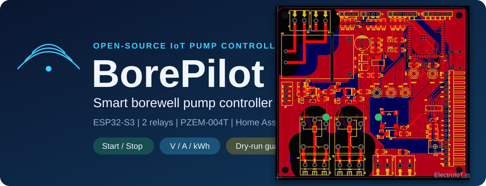

# BorePilot

**ESP32-S3 smart borewell pump controller: start, stop and protect a single-phase submersible pump from Home Assistant, with live voltage, current and energy.**

     

</div>

> **Status (2026-11-11).** Schematic finished (ERC clean), PCB routed with **0 DRC errors**, every connector pin and button labelled on the silkscreen, Gerber and assembly files exported. **The board has not been built or tested and the firmware is not written yet.** The board involves 230 V AC: read [docs/safety.md](docs/safety.md) first, use low-voltage loads on the bench and have a qualified person review the mains section before you power it.

## Contents
[Features](#features) | [Board tour](#board-tour-animated) | [3D views](#3d-views) | [How it works](#how-it-works) | [Connectors](#connectors-and-labels) | [GPIO map](#gpio-map) | [Schematic](#schematic) | [Bill of materials](#bill-of-materials) | [Manufacturing files](#manufacturing-files) | [Ordering](#ordering-the-board) | [Documents](#design-documents) | [Open items](#open-items) | [Safety](#safety) | [Repository map](#repository-map)

## Features

| | | |
|---|---|---|
| **Pump control** | 2 SPDT relays (Songle SRD-05VDC-SL-C), NO / COM / NC on 5.08 mm screw terminals | START / STOP for a contactor or a small pump |
| **Energy and protection** | PZEM-004T v3 header: voltage, current, power, energy, frequency | dry-run and over-current stop (in firmware) |
| **Home Assistant** | ESP32-S3-WROOM-1U-N16R8, Wi-Fi, external antenna through U.FL | ESPHome, same entities as the Smart-Submersible-Pump-Controller-ESPHome package |
| **Display options** | 16x2 I2C LCD, I2C OLED or 128x64 ST7920 on one board | START / STOP / MENU buttons, buzzer, status LEDs |
| **Level inputs** | 2 float-switch inputs, spare GPIO header | optional wireless tank node (ESP-NOW), see [TankPilot](https://github.com/ElectroIoT/ESP32-S3-TankPilot) |
| **Power** | Hi-Link HLK-5M05 (5 V / 1 A), 470 uF bulk, SGM2212 3.3 V LDO | USB-C for flashing and logs (native USB, no UART chip) |
| **Mains aware layout** | two 8 x 1 mm slots per relay between COM and the coil, 6.4 mm clearance goal | no on-board fuse or varistor: protect upstream |
| **Labelled** | every connector pin and button has a silkscreen name (top and bottom) | START, STOP, MENU, RESET, BOOT, NO, COM, NC, L, N ... |

## Board tour (animated)


## 3D views

<div align="center">
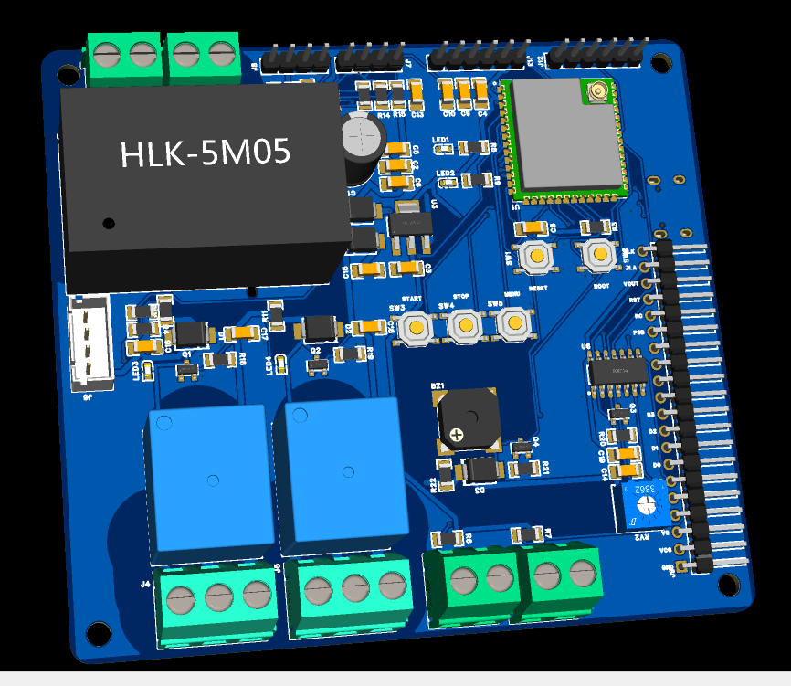 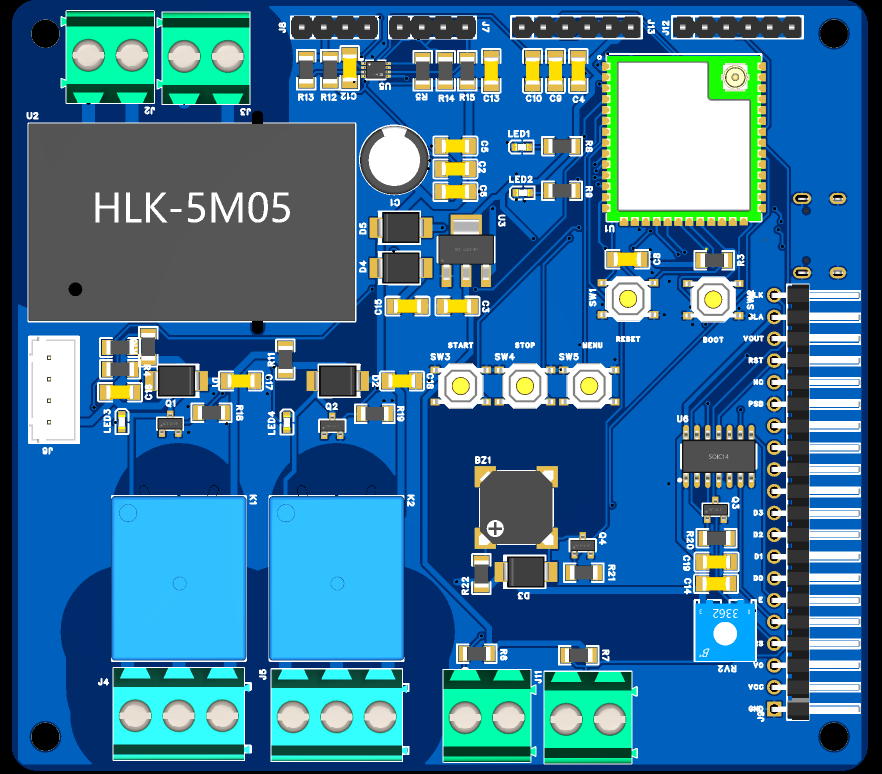
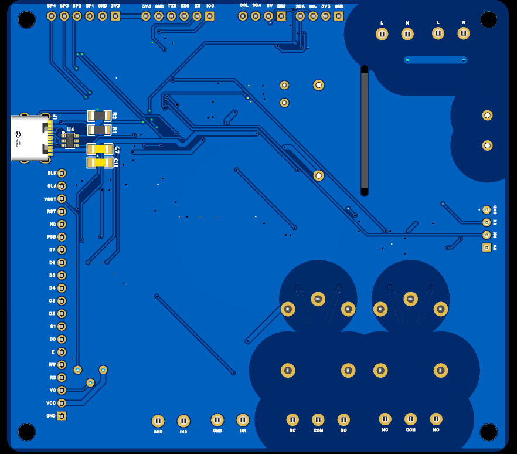 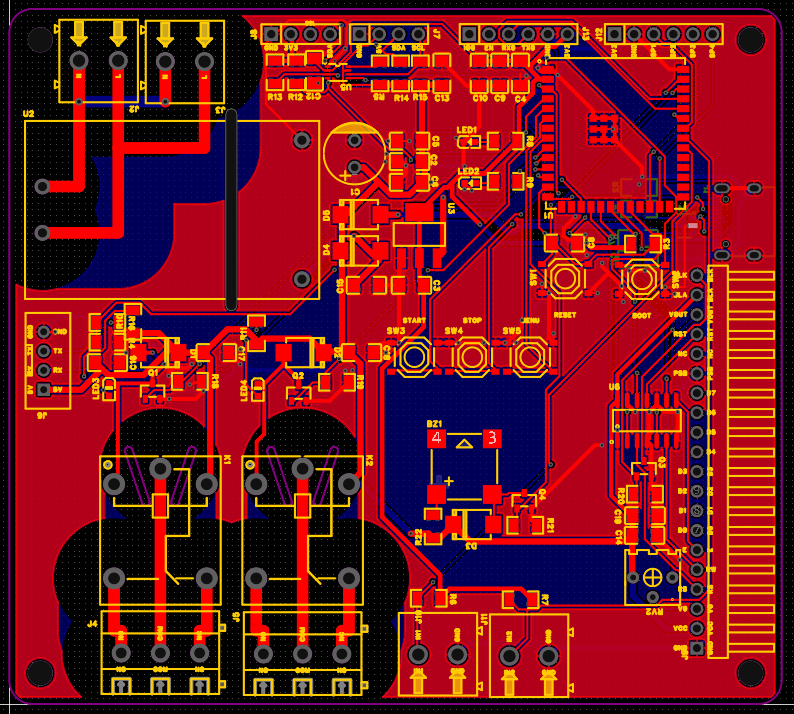

*3D renders from EasyEDA (blue solder mask). Bottom right: the routed top copper (red = top, blue = bottom). The USB-C socket and its ESD part sit on the bottom side.*
</div>

| | |
|---|---|
| Size | 100 x 90 mm, 2 layers, 1.6 mm, four M3 mounting holes (4, 4), (96, 4), (4, 86), (96, 86) |
| Mains side | J2 (AC in), J3 (AC tap for the PZEM), HLK-5M05, relay contacts J4 / J5 |
| Isolation | two 8 x 1 mm slots per relay between COM and the coil pins, slot in the HLK-5M05 area |
| Tracks | mains and relay contacts 1.5 mm, +5 V 0.8 mm, +3V3 0.6 mm, coil 0.5 mm, USB and signals 0.25 mm, GND pour on both layers |
| DRC | 0 errors (JLCPCB capability rules plus a BorePilot rule set with mains spacing) |
| Parts | 81 on the board, 82 pieces in the BOM, about 16.23 USD with the listing prices of 2026-10-28 |

## How it works

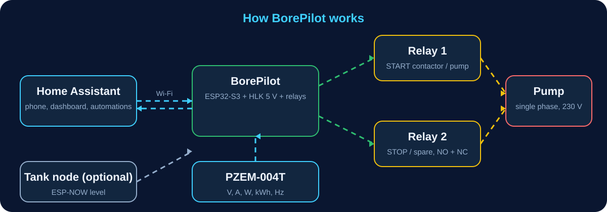

The ESP32-S3 talks to Home Assistant over Wi-Fi (ESPHome). It switches the two relays through low-side MOSFETs, reads the PZEM-004T over UART and the two float inputs, and shows the state on one of three display options. The relay coils run from the 5 V rail; the HLK-5M05 makes 5 V from the mains, and USB-C can power the board for flashing.

## Connectors and labels

Pin names below are printed next to the pins on the board.

| Ref | What | Pins (left to right as printed) |
|---|---|---|
| J1 | USB-C (bottom side) | programming, logs, 5 V |
| J2 | AC in (2P) | L, N |
| J3 | AC tap for the PZEM voltage input (2P) | L, N |
| J4 | Relay 1 contacts (3P) | NO, COM, NC |
| J5 | Relay 2 contacts (3P) | NO, COM, NC |
| J6 | PZEM-004T link (XH 4P) | 5V, RX, TX, GND (module side names) |
| J7 | 16x2 I2C LCD (1x4) | GND, 5V, SDA, SCL |
| J8 | I2C OLED (1x4) | GND, 3V3, SCL, SDA |
| J9 | 128x64 ST7920 (1x20) | GND, VCC, V0, RS, RW, E, D0 to D7, PSB, NC, RST, VOUT, BLA, BLK |
| J10, J11 | float switch 1 and 2 (2P) | IN, GND |
| J12 | spare I/O (1x6) | 3V3, GND, SP1 to SP4 |
| J13 | UART / boot header (1x6, not fitted) | IO0, EN, RX0, TX0, GND, 3V3 |
| SW1 to SW5 | buttons | RESET, BOOT, START, STOP, MENU |

## GPIO map

| GPIO | Net | Use |
|---|---|---|
| EN, 0 | EN, BOOT | SW1 reset, SW2 boot (strapping pin) |
| 19 / 20 | USB D- / D+ | native USB through U4 ESD part |
| 8 / 9 | SDA / SCL | I2C: OLED direct, 16x2 LCD through U5 PCA9306 level shifter |
| 17 / 18 | PZEM_TX / PZEM_RX | UART1 9600 baud to J6, RX through a divider |
| 4, 5 | RLY1, RLY2 | relay drivers (AO3400A, active high) |
| 10 to 14 | LCD_CS, MOSI, CLK, BL, RST | ST7920 through U6 74AHCT125 |
| 1, 2, 6 | START, STOP, MENU | buttons to GND, internal pull-ups |
| 15, 16 | BUZZER, LED_STATUS | optional buzzer, red status LED |
| 39, 40 | IN1, IN2 | float-switch inputs |
| 41, 42 | SPARE1, SPARE2 | J12 |
| 43, 44 | TXD0, RXD0 | J13 |

Details: [PLAN.md](PLAN.md) section 4 and [docs/connection-diagram.html](docs/connection-diagram.html).

## Schematic

Five pages, drawn in EasyEDA Pro, ERC clean. Full PDF: [hardware/schematic/BorePilot_Schematic.pdf](hardware/schematic/BorePilot_Schematic.pdf).

| Page | What |
|---|---|
| 1. Power and USB | mains input J2 / J3, HLK-5M05, Schottky OR-ing, 470 uF, SGM2212 3.3 V LDO, USB-C with ESD part |
| 2. ESP32-S3 core | WROOM-1U module, EN and BOOT buttons, decoupling |
| 3. Relays and mains contacts | two SRD relays, AO3400A drivers, flyback diodes, coil LEDs, J4 / J5 |
| 4. PZEM link and I/O | PZEM header with divider, START / STOP / MENU, LEDs, buzzer, float inputs, spare header |
| 5. Display options | 16x2 LCD through PCA9306, OLED, ST7920 through 74AHCT125, contrast and backlight |

<details><summary>Show the five schematic pages</summary>

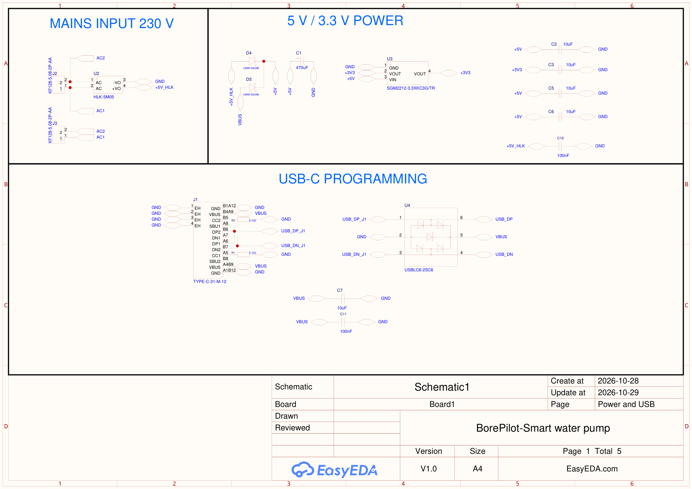
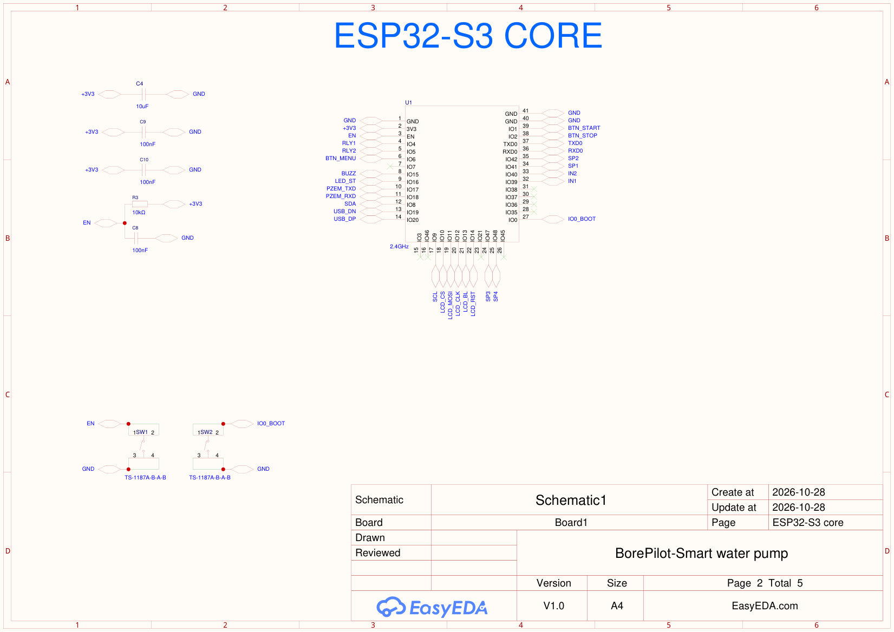
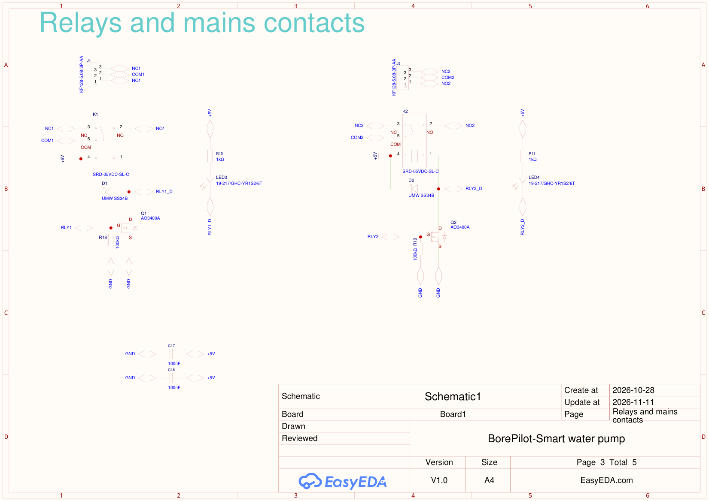
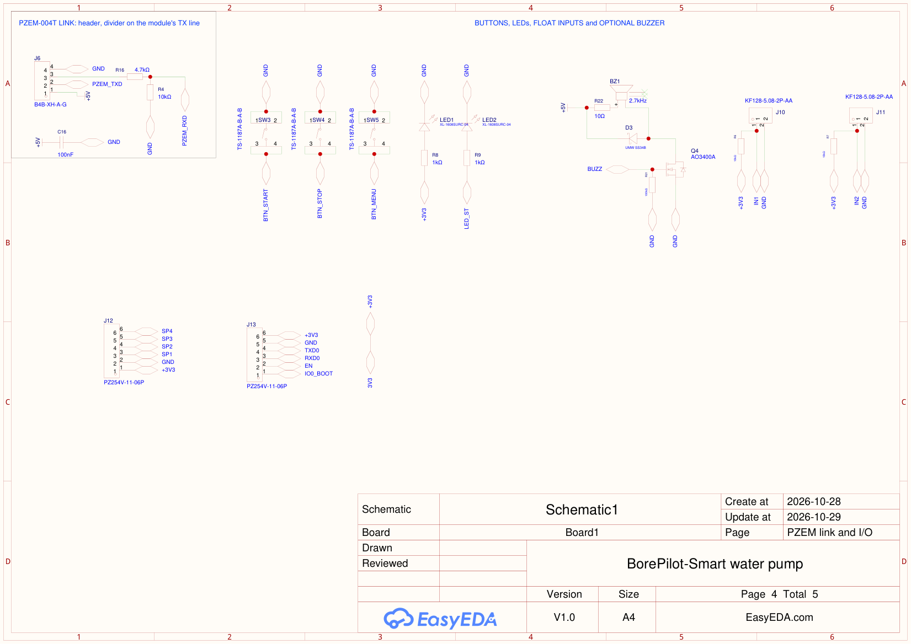
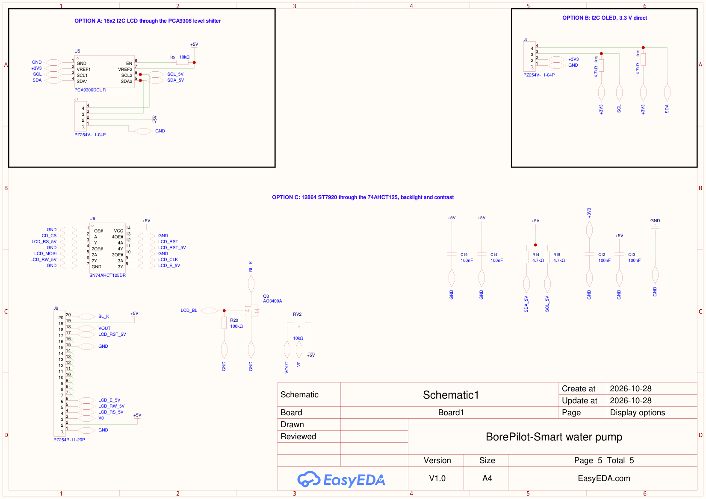

</details>

Page-by-page build guide, wiring diagrams and the schematic review are listed under [Design documents](#design-documents).

## Bill of materials

82 pieces in the repository BOM, about 16.23 USD (listing prices and LCSC numbers of 2026-10-28; several datasheets are not read yet, see [PLAN.md](PLAN.md)). Files: [hardware/bom/pump-controller-bom-v0.csv](hardware/bom/pump-controller-bom-v0.csv) (with stock and prices) and [hardware/assembly/BorePilot_BOM.csv](hardware/assembly/BorePilot_BOM.csv) (EasyEDA export, 81 pieces, for assembly). Parts marked *optional* are fitted only if you want that feature.

**MAINS INPUT 230 V**  
<sub>Hazardous side. No fuse or varistor on board (owner decision): protect upstream.</sub>

| Ref | Qty | Function | Part | LCSC |
|---|---:|---|---|---|
| J2, J3 | 2 | AC in screw terminal 2P 5.08 mm / AC tap to PZEM voltage input | `KF128-5.08-2P-AA` | [C474952](https://www.lcsc.com/product-detail/C474952.html) |
| U2 | 1 | HLK-5M05 AC-DC 5 V 1 A module | `HLK-5M05` | [C209907](https://www.lcsc.com/product-detail/C209907.html) |

**5 V / 3.3 V POWER**  
<sub>HLK-5M05 and USB VBUS OR-ed through Schottky diodes to +5V, then SGM2212 LDO to +3V3.</sub>

| Ref | Qty | Function | Part | LCSC |
|---|---:|---|---|---|
| D4, D5 | 2 | Schottky OR-ing: HLK to +5V / Schottky OR-ing: USB VBUS to +5V | `UMW SS34B` | [C2758511](https://www.lcsc.com/product-detail/C2758511.html) |
| C1 | 1 | 470 uF 16 V bulk on +5V | `ERG16V470M8X12` | [C47344174](https://www.lcsc.com/product-detail/C47344174.html) |
| U3 | 1 | SGM2212-3.3 LDO | `SGM2212-3.3XKC3G/TR` | [C3294699](https://www.lcsc.com/product-detail/C3294699.html) |
| C2, C3, C5, C6 | 4 | 10 uF 1206 | `CL31A106KAHNNNE` | [C9807](https://www.lcsc.com/product-detail/C9807.html) |
| C15 | 1 | 100 nF 1206 | `CL31B104KBCNNNC` | [C24497](https://www.lcsc.com/product-detail/C24497.html) |

**USB-C PROGRAMMING**  
<sub>C165948 USB-C, native USB on GPIO19/20, 5.1 k CC resistors, ESD part.</sub>

| Ref | Qty | Function | Part | LCSC |
|---|---:|---|---|---|
| J1 | 1 | USB-C 16-pin receptacle (user part C165948) | `TYPE-C-31-M-12` | [C165948](https://www.lcsc.com/product-detail/C165948.html) |
| U4 | 1 | USBLC6-2SC6 ESD protection | `USBLC6-2SC6` | [C7519](https://www.lcsc.com/product-detail/C7519.html) |
| R1, R2 | 2 | 5.1 k | `1206W4F5101T5E` | [C26033](https://www.lcsc.com/product-detail/C26033.html) |
| C7 | 1 | 10 uF 1206 | `CL31A106KAHNNNE` | [C9807](https://www.lcsc.com/product-detail/C9807.html) |
| C11 | 1 | 100 nF 1206 | `CL31B104KBCNNNC` | [C24497](https://www.lcsc.com/product-detail/C24497.html) |

**ESP32-S3 CORE**  
<sub>WROOM-1U (external antenna), EN/BOOT buttons, decoupling.</sub>

| Ref | Qty | Function | Part | LCSC |
|---|---:|---|---|---|
| U1 | 1 | ESP32-S3-WROOM-1U-N16R8 module | `ESP32-S3-WROOM-1U-N16R8` | [C3013946](https://www.lcsc.com/product-detail/C3013946.html) |
| ANT1 | 1 | U.FL to SMA pigtail 200 mm | `KH-IPEX-SMA-W-200` | [C2683345](https://www.lcsc.com/product-detail/C2683345.html) |
| ANT2 | 1 | 2.4 GHz SMA antenna (NOT CHOSEN YET) | `TBD` | TBD |
| J13 | 1 | UART / BOOT header 1x6 (not fitted by default) | `PZ254V-11-06P` | [C492405](https://www.lcsc.com/product-detail/C492405.html) |
| SW1, SW2 | 2 | Reset button (EN) / BOOT button (GPIO0) | `TS-1187A-B-A-B` | [C318884](https://www.lcsc.com/product-detail/C318884.html) |
| R3 | 1 | 10 k | `1206W4F1002T5E` | [C17902](https://www.lcsc.com/product-detail/C17902.html) |
| C4 | 1 | 10 uF 1206 | `CL31A106KAHNNNE` | [C9807](https://www.lcsc.com/product-detail/C9807.html) |
| C8, C9, C10 | 3 | 100 nF 1206 | `CL31B104KBCNNNC` | [C24497](https://www.lcsc.com/product-detail/C24497.html) |

**RELAYS 1 and 2**  
<sub>Two SPDT relays, COM/NO/NC on 5.08 mm terminals, low-side AO3400A drivers.</sub>

| Ref | Qty | Function | Part | LCSC |
|---|---:|---|---|---|
| K1, K2 | 2 | Relay 1 / Relay 2 | `SRD-05VDC-SL-C` | [C35449](https://www.lcsc.com/product-detail/C35449.html) |
| Q1, Q2 | 2 | AO3400A driver | `AO3400A` | [C20917](https://www.lcsc.com/product-detail/C20917.html) |
| D1, D2 | 2 | Schottky flyback | `UMW SS34B` | [C2758511](https://www.lcsc.com/product-detail/C2758511.html) |
| R18, R19 | 2 | 100 k gate pull-down Q1 / 100 k gate pull-down Q2 | `1206W4F1003T5E` | [C17900](https://www.lcsc.com/product-detail/C17900.html) |
| R10, R11 | 2 | 1 k | `1206W4F1001T5E` | [C4410](https://www.lcsc.com/product-detail/C4410.html) |
| LED3, LED4 | 2 | Green LED: relay 1 energised / Green LED: relay 2 energised | `19-217/GHC-YR1S2/6T` | [C2986059](https://www.lcsc.com/product-detail/C2986059.html) |
| J4, J5 | 2 | Relay 1 terminal 3P: NO/COM/NC / Relay 2 terminal 3P: NO/COM/NC | `KF128-5.08-3P-AA` | [C474953](https://www.lcsc.com/product-detail/C474953.html) |
| C17, C18 | 2 | 100 nF 1206 | `CL31B104KBCNNNC` | [C24497](https://www.lcsc.com/product-detail/C24497.html) |

**PZEM-004T LINK**  
<sub>UART1 header for the external PZEM-004T v3 module.</sub>

| Ref | Qty | Function | Part | LCSC |
|---|---:|---|---|---|
| J6 | 1 | JST XH 4P header for PZEM-004T | `B4B-XH-A-G` | [C594232](https://www.lcsc.com/product-detail/C594232.html) |
| R16 | 1 | 4.7 k | `1206W4F4701T5E` | [C17936](https://www.lcsc.com/product-detail/C17936.html) |
| R4 | 1 | 10 k | `1206W4F1002T5E` | [C17902](https://www.lcsc.com/product-detail/C17902.html) |
| C16 | 1 | 100 nF 1206 | `CL31B104KBCNNNC` | [C24497](https://www.lcsc.com/product-detail/C24497.html) |

**DISPLAY OPTIONS**  
<sub>16x2 I2C LCD (via PCA9306), I2C OLED, 12864 ST7920 (via 74AHCT125). Fit one.</sub>

| Ref | Qty | Function | Part | LCSC |
|---|---:|---|---|---|
| J7, J8 | 2 | 1x4 header: 16x2 I2C LCD / 1x4 header: I2C OLED | `PZ254V-11-04P` | [C2691448](https://www.lcsc.com/product-detail/C2691448.html) |
| J9 | 1 | 1x20 female header: 12864 ST7920 | `PZ254R-11-20P` | [C41413628](https://www.lcsc.com/product-detail/C41413628.html) |
| U5 | 1 | PCA9306 I2C level shifter (16x2 only) | `PCA9306DCUR` | [C33196](https://www.lcsc.com/product-detail/C33196.html) |
| U6 | 1 | SN74AHCT125 3.3 V to 5 V buffer (12864 only) | `SN74AHCT125DR` | [C155176](https://www.lcsc.com/product-detail/C155176.html) |
| Q3 | 1 | AO3400A backlight switch | `AO3400A` | [C20917](https://www.lcsc.com/product-detail/C20917.html) |
| RV2 | 1 | 10 k trimmer | `3362P-1-103LF` | [C58159](https://www.lcsc.com/product-detail/C58159.html) |
| R12, R13, R14, R15 | 4 | 4.7 k *(optional)* | `1206W4F4701T5E` | [C17936](https://www.lcsc.com/product-detail/C17936.html) |
| R5 | 1 | 10 k | `1206W4F1002T5E` | [C17902](https://www.lcsc.com/product-detail/C17902.html) |
| R20 | 1 | 100 k gate pull-down Q3 | `1206W4F1003T5E` | [C17900](https://www.lcsc.com/product-detail/C17900.html) |
| C12, C13, C14, C19 | 4 | 100 nF 1206 | `CL31B104KBCNNNC` | [C24497](https://www.lcsc.com/product-detail/C24497.html) |

**BUTTONS / LEDs / INPUTS**  
<sub>START, STOP, MENU, status LEDs, optional buzzer, float inputs, spare GPIO.</sub>

| Ref | Qty | Function | Part | LCSC |
|---|---:|---|---|---|
| SW3, SW4, SW5 | 3 | START button / STOP button | `TS-1187A-B-A-B` | [C318884](https://www.lcsc.com/product-detail/C318884.html) |
| LED1, LED2 | 2 | Red LED: power / Red LED: Wi-Fi / status | `XL-1608SURC-04` | [C965798](https://www.lcsc.com/product-detail/C965798.html) |
| R8, R9 | 2 | 1 k | `1206W4F1001T5E` | [C4410](https://www.lcsc.com/product-detail/C4410.html) |
| BZ1 | 1 | passive buzzer MLT-8530 *(optional)* | `MLT-8530` | [C94599](https://www.lcsc.com/product-detail/C94599.html) |
| R22 | 1 | 10 ohm series resistor for BZ1 (limits buzzer voltage) *(optional)* | `1206W4F100JT5E` | [C17903](https://www.lcsc.com/product-detail/C17903.html) |
| Q4 | 1 | AO3400A buzzer driver *(optional)* | `AO3400A` | [C20917](https://www.lcsc.com/product-detail/C20917.html) |
| D3 | 1 | Schottky flyback across buzzer *(optional)* | `UMW SS34B` | [C2758511](https://www.lcsc.com/product-detail/C2758511.html) |
| R21 | 1 | 100 k gate pull-down Q4 *(optional)* | `1206W4F1003T5E` | [C17900](https://www.lcsc.com/product-detail/C17900.html) |
| J10, J11 | 2 | Float input 1 screw terminal 2P / Float input 2 screw terminal 2P | `KF128-5.08-2P-AA` | [C474952](https://www.lcsc.com/product-detail/C474952.html) |
| J12 | 1 | 1x6 spare header | `PZ254V-11-06P` | [C492405](https://www.lcsc.com/product-detail/C492405.html) |
| R6, R7 | 2 | 10 k optional pull-up IN1 / 10 k optional pull-up IN2 *(optional)* | `1206W4F1002T5E` | [C17902](https://www.lcsc.com/product-detail/C17902.html) |

Not on the board: ANT1 (U.FL to SMA pigtail, KH-IPEX-SMA-W-200, C2683345) and ANT2 (2.4 GHz SMA antenna, not chosen yet); the PZEM-004T v3 module; fuse clips.

## Manufacturing files

| File | What |
|---|---|
| [hardware/gerber/BorePilot_Gerber_2026-11-11.zip](hardware/gerber/BorePilot_Gerber_2026-11-11.zip) | Gerber and drill files, upload to the PCB maker |
| [hardware/assembly/BorePilot_PickAndPlace.csv](hardware/assembly/BorePilot_PickAndPlace.csv) | pick and place (centroid) file, also as [.xlsx](hardware/assembly/BorePilot_PickAndPlace.xlsx) |
| [hardware/assembly/BorePilot_BOM.csv](hardware/assembly/BorePilot_BOM.csv) | assembly BOM with LCSC part numbers, also as [.xlsx](hardware/assembly/BorePilot_BOM.xlsx) |
| [hardware/schematic/BorePilot_Schematic.pdf](hardware/schematic/BorePilot_Schematic.pdf) | schematic, 5 pages |
| [hardware/pcb/BorePilot_PCB_Layers.pdf](hardware/pcb/BorePilot_PCB_Layers.pdf) | PCB layer drawings |
| [hardware/netlist/BorePilot_Netlist.enet](hardware/netlist/BorePilot_Netlist.enet) | netlist (EasyEDA format) |

The design is made in EasyEDA Pro (project "BorePilot-Smart water pump"). The Gerber, pick-and-place and BOM files were exported from the final routed board on 2026-11-11.

## Ordering the board

1. Upload the Gerber zip to your PCB maker (JLCPCB or PCBWay): 2 layers, 100 x 90 mm, 1.6 mm, 1 oz copper. The board has milled slots (relay slots): tell the maker to keep them.
2. For assembly, upload the BOM and pick-and-place files. Through-hole parts (screw terminals, headers, HLK module, relays, electrolytic capacitor) are hand-soldered. The 230 V part of the board is for qualified builders.
3. Order a small batch first: the board is untested.

## Design documents

| What | Where |
|---|---|
| Project plan, power budget, safety notes, open questions | [PLAN.md](PLAN.md) |
| BOM by section and by schematic page (tick lists with LCSC links) | [docs/bom-by-section.html](docs/bom-by-section.html), [docs/bom-by-page.html](docs/bom-by-page.html) |
| Schematic build guide for EasyEDA Pro (page by page, net names) | [docs/schematic-guide.html](docs/schematic-guide.html) |
| Wiring by section, connection diagram | [docs/wiring-by-section.html](docs/wiring-by-section.html), [docs/connection-diagram.html](docs/connection-diagram.html) |
| Footprint check against datasheets (K1, U2, J1, KF128, BZ1) | [docs/footprints.html](docs/footprints.html) |
| Footprint fixes, relay slots and placement table (tick list) | [docs/footprint-placement.html](docs/footprint-placement.html) |
| PCB floor plan by block (planning floor plan: the final board differs in detail) | [docs/pcb-section-guide.html](docs/pcb-section-guide.html) |
| Schematic review (8 errors found and fixed) | [docs/schematic-review-2026-10-28.md](docs/schematic-review-2026-10-28.md) |
| Safety | [docs/safety.md](docs/safety.md) |

## Open items

- **Firmware:** not written. Plan: reuse the ESPHome package, add a latched pump state, start-up grace time, hysteresis and minimum off-time (PLAN.md section 2).
- **Mains section:** needs a qualified engineer review: no fuse or varistor on board, no protective earth through the PCB, HLK-5M05 EMC parts (X2 capacitor, choke) not fitted.
- **Relay area:** relay coil tracks run within about 4 to 6 mm of the COM track; the slots lengthen the surface path, measured distances are in [docs/footprint-placement.html](docs/footprint-placement.html).
- **Datasheets not read** for SGM2212, PCA9306, SS34B, MLT-8530, KF128 ratings, ST7920 and PZEM-004T v3; footprints of U1, U3 to U6 and J9 are not compared with drawings.
- **Nothing has been tested on hardware.**

## Safety

This board switches mains. Build and test it only if you know how to work safely with 230 V AC. Use low-voltage loads on the bench until the mains section has been reviewed, and keep the board in an enclosure with the terminals covered. See [docs/safety.md](docs/safety.md).

## Repository map

```
.
|-- PLAN.md              full project plan
|-- hardware/
|   |-- gerber/          Gerber + drill zip
|   |-- assembly/        BOM and pick-and-place (csv, xlsx)
|   |-- schematic/       schematic PDF
|   |-- pcb/             PCB layer PDF
|   |-- netlist/         EasyEDA netlist
|   `-- bom/             LCSC BOM with stock and prices
|-- docs/                guides, wiring, BOM pages, footprint and placement sheets
|   |-- images/          renders, board view, animated SVGs, social cards
|   `-- schematic/       schematic pages as PNG
|-- firmware/esphome/    ESPHome package (not written yet)
|-- test/                hardware test plan (later)
`-- tools/               generators for the docs pages, README and images
```

## License

[MIT](LICENSE).
